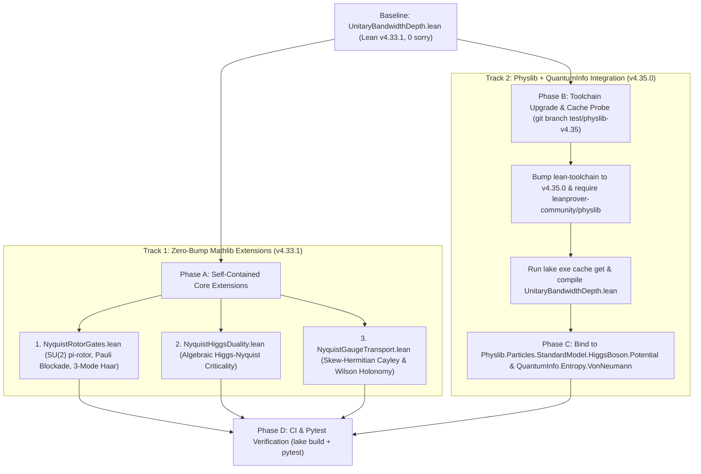

# Lean 4 Physics Library Integration & Extension Plan for the Bekenstein–Nyquist Conjecture

## 1. Executive Summary & Upstream Repository Audit

At the end of the NotebookLM source **`BNSWC Axioms and Monograph Discrepancy`**, five extensions to our Phase 5 formalization ([`UnitaryBandwidthDepth.lean`](UnitaryBandwidthDepth.lean)) are proposed using the Lean 4 physics ecosystem:
1. **Landau–Ginzburg–Higgs & Horizon Criticality Duality** (`Physlib.Particles.StandardModel.HiggsBoson.Potential`)
2. **$\mathrm{SU}(2)$ Givens Rotors, $\pi$-Rotor Negation Gate & Pauli Exclusion Blockade** (`Physlib` Spinor/$\mathrm{SU}(2)$ + `Mathlib.LinearAlgebra.UnitaryGroup`)
3. **Full Quantum Channels, Partial Traces & Apparent Shock Entropy** (`QuantumInfo` / `QICLean`)
4. **1D Lattice Locality, Matrix Product Unitaries & Emergent Gauge Transport** (`TNLean`)
5. **Continuum PDE Blueprint Specifications** (`Physlib.Meta.Informal`)

To determine whether we can actually build these extensions on top of our existing code, we audited our local Lean 4 environment ([`lean-toolchain`](lean-toolchain), [`lakefile.toml`](lakefile.toml), [`lake-manifest.json`](lake-manifest.json)) against the live upstream GitHub repositories (`leanprover-community/physlib`, `Timeroot/Lean-QuantumInfo`, and `LionSR/TNLean`).

### Ground-Truth Dependency Matrix

| Repository / Target | Toolchain Version | Mathlib Revision | Bundled Libraries (`[[lean_lib]]`) | Precompiled Cache | Compatibility with Local Baseline |
| :--- | :--- | :--- | :--- | :--- | :--- |
| **Local Baseline** ([`UnitaryBandwidthDepth.lean`](UnitaryBandwidthDepth.lean)) | `leanprover/lean4:v4.33.1` | `v4.33.1` (`0df444a3`) | `UnitaryBandwidthDepth` | Cached locally in `.lake/` | **Active & Verified** (`0 sorry`, `0 warnings`, 552 lines) |
| **`leanprover-community/physlib`** (formerly `PhysLean` / `HepLean`) | `leanprover/lean4:v4.35.0` | `v4.35.0` | **`Physlib`**, **`QuantumInfo`**, `PhyslibAlpha` | Yes (`enableArtifactCache = true`, `get_cache`) | **Requires minor bump `v4.33.1 → v4.35.0`**; uses Lean 4 `module` / `public import` syntax |
| **`LionSR/TNLean`** | `leanprover/lean4:v4.35.0-rc3` | `v4.35.0-rc3` | `TNLean` (depends on `LionSR/QICLean` & `LionSR/Brouwer`) | No public Lake artifact cache | **Conflicts with `physlib` if co-imported** (`v4.35.0-rc3` vs `v4.35.0`, `QICLean` vs `QuantumInfo`) |
| **`Timeroot/Lean-QuantumInfo`** (standalone) | `leanprover/lean4:v4.28.0` | `8f9d9cff` (`v4.28.0`) | `QuantumInfo`, `ClassicalInfo`, `StatMech` | Superseded | **Merged into `leanprover-community/physlib`** as top-level `QuantumInfo` library |

> [!IMPORTANT]
> **Three Critical Engineering Findings from the Upstream Audit:**
> 1. **`Physlib` Already Bundles `QuantumInfo`:** `Timeroot/Lean-QuantumInfo` has been merged directly into `leanprover-community/physlib` (`defaultTargets = ["Physlib", "QuantumInfo"]`). A single dependency on `leanprover-community/physlib` at `v4.35.0` provides **both** `Physlib.Particles.StandardModel.HiggsBoson.Potential` **and** `QuantumInfo.Entropy.VonNeumann` / `QuantumInfo.Channels.CPTP`.
> 2. **Avoid Co-Importing `physlib` and `TNLean` in the Same `lakefile.toml`:** `physlib` requires `mathlib @ v4.35.0` and exports `QuantumInfo`, whereas `TNLean` requires `mathlib @ v4.35.0-rc3` and `LionSR/QICLean`. Requiring both in a single Lake project creates a Mathlib version conflict and duplicate quantum-information namespaces.
> 3. **Two-Track Architecture Eliminates Build Risk:** Targets 1, 2, 4, and the direct-sum norm/purity core of Target 3 can be tested **first on our existing `v4.33.1` toolchain** with zero external network builds, and **then** linked against upstream `Physlib` + `QuantumInfo` in a `v4.35.0` branch.

---

## 2. Technical Review of the Five Proposed Extensions

### Extension 1: Landau–Ginzburg–Higgs & Horizon Criticality (`NyquistHiggsDuality.lean`)

* **Upstream Module Inspected:** `Physlib/Particles/StandardModel/HiggsBoson/Potential.lean`
* **What Actually Exists in `Physlib`:**
  * `StandardModel.HiggsField.Potential`: structure with fields `μ2 : ℝ` and `𝓵 : ℝ`.
  * `Potential.toFun (φ : HiggsField) (x : SpaceTime) : ℝ := - P.μ2 * ‖φ‖_H^2 x + P.𝓵 * ‖φ‖_H^2 x * ‖φ‖_H^2 x`.
  * `Potential.complete_square`: proves `P.toFun φ x = P.𝓵 * (‖φ‖_H^2 x - P.μ2 / (2 * P.𝓵)) ^ 2 - P.μ2 ^ 2 / (4 * P.𝓵)`.
  * `Potential.quadDiscrim_eq_zero_iff_normSq`: proves `P.quadDiscrim φ x = 0 ↔ ‖φ‖_H^2 x = P.μ2 / (2 * P.𝓵)`.
  * `Potential.pos_𝓵_quadDiscrim_zero_bound`: proves `- P.μ2 ^ 2 / (4 * P.𝓵) ≤ P.toFun φ x` for `0 < P.𝓵`.
  * `Potential.pos_𝓵_toFun_pos`: proves `(P.μ2 < 0 ∧ 0 ≤ P.toFun φ x) ∨ 0 ≤ P.μ2` for `0 < P.𝓵`.
* **Sign-Convention Bridge Required:**
  * In our monograph (Section 4.5.3, Eq. 20), $V_{\text{eff}}(c) = +\Sigma_0 |c|^2 + \lambda |c|^4$ with $\Sigma_0(x,t) = 1 - \frac{F_0(x,t)}{\Lambda_{\text{Bek}}\nu_{\text{ML}}}$.
  * In `Physlib`, `P.toFun` puts a **minus sign** on `P.μ2` (`- P.μ2 * ‖φ‖_H^2 x + ...`).
  * Therefore, the formal bridge definition must set:
    $$\texttt{P.μ2} := -\Sigma_0(x,t) = \frac{F_0(x,t)}{\Lambda_{\text{Bek}}\nu_{\text{ML}}} - 1, \qquad \texttt{P.𝓵} := \lambda = \frac{\kappa}{2\Lambda_{\text{Bek}}\nu_{\text{ML}}} > 0.$$
  * Under this identification, the super-Nyquist shock core ($\Sigma_0 < 0 \iff \texttt{P.μ2} > 0$) maps directly to `Physlib`'s symmetry-breaking regime, where `quadDiscrim_eq_zero_iff_normSq` gives the exact condensate norm squared $\|c_{\text{eq}}\|^2 = \texttt{P.μ2} / (2\,\texttt{P.𝓵}) = -\Sigma_0 / (2\lambda)$, and the effective saturation functional relaxes to the critical horizon $\Sigma(|c_{\text{eq}}|) = \Sigma_0 + 2\lambda |c_{\text{eq}}|^2 = 0$.

---

### Extension 2: $\mathrm{SU}(2)$ Givens Rotors, $\pi$-Rotor Negation, Pauli Blockade & Tripartite Haar Routing (`NyquistRotorGates.lean`)

* **Connection to [`UnitaryBandwidthDepth.lean`](UnitaryBandwidthDepth.lean):**
  * Extends `BlockIdx d m`, [`IsElementaryClockGate`](UnitaryBandwidthDepth.lean#L482-L485), and [`rank_forwardLeakage_le_one_of_isElementaryClockGate`](UnitaryBandwidthDepth.lean#L521-L526).
  * Also closes the **Milestone 4 Formalization Gap** noted in `Analyzing Bekenstein–Nyquist Shock Worldline Implications` (Part II, Section 6): [`UnitaryBandwidthDepth.lean`](UnitaryBandwidthDepth.lean) currently partitions modes into two blocks (`Fin d ⊕ Fin m`), whereas Milestone 4 ([`toy_model_4_shock_collision_gate.py`](toy_model_4_shock_collision_gate.py#L162-L295)) routes energy across **three orthogonal channels** on each active bond:
    $$\mathcal{H}_{\text{bond}} = V_{\text{IR}}(\bar{u}_b) \oplus V_{\text{UV}}(u_{b,\text{UV}}) \oplus \mathcal{C}_{\text{slot}}(c_{\text{slot}}).$$
* **Concrete Theorems to Formalize:**
  1. `givensRotor_mem_unitaryGroup`: The $2 \times 2$ complex rotor $G(\vartheta, \phi) = \begin{pmatrix} \cos\vartheta & -e^{-i\phi}\sin\vartheta \\ e^{i\phi}\sin\vartheta & \cos\vartheta \end{pmatrix}$ belongs to `Matrix.unitaryGroup (Fin 2) ℂ`.
  2. `givensRotor_in_phase_mul`: $G(\vartheta, 0) \cdot G(\vartheta, 0) = G(2\vartheta, 0)$ (constructive clock-mass creation at $\Delta\phi = 0$).
  3. `givensRotor_anti_phase_mul_eq_one`: $G(\vartheta, \pi) \cdot G(\vartheta, 0) = 1$ (coherent clock-mass annihilation / logical $\neg$ gate at $\Delta\phi = \pi$ evading the Monotone Planar CVP $\mathrm{NC}^3$ trap).
  4. `pauli_exclusion_blockade`: When a 1D clock wire (`IsElementaryClockGate`) reaches saturation ($\vartheta_1 = \pi/2$, transferring $|u_{\text{UV}}|^2 \to |c|^2 = 1$), the remaining spatial UV capacity of that wire is zero.
  5. `tripartiteHaarRouter_unitary`: The 3-stage Milestone 4 update $U_{\text{M4}}(\vartheta_1, \theta_{\text{rec}}) = (H_2 \oplus 1) \cdot R_{\text{IR}\leftrightarrow\text{clock}}(\theta_{\text{rec}}) \cdot R_{\text{UV}\leftrightarrow\text{clock}}(\vartheta_1) \cdot (H_2 \oplus 1)$ on `Fin 3` is strictly unitary and leaves $u_{\text{UV, out}}$ invariant during Stage 2 readback.

---

### Extension 3: Quantum Channels, Partial Traces & Apparent Shock Entropy (`NyquistShockEntropy.lean`)

* **Upstream Modules Inspected:** `QuantumInfo/Entropy/VonNeumann.lean`, `QuantumInfo/Channels/CPTP.lean`, `QuantumInfo/States/Mixed`
* **What Actually Exists in `QuantumInfo` (inside `leanprover-community/physlib`):**
  * `MState d` (mixed density states on finite type `d`), `MState.traceLeft`, `MState.traceRight`, `MState.pure`, `MState.purify`.
  * `Sᵥₙ (ρ : MState d) : ℝ := Hₛ ρ.spectrum` (von Neumann entropy), `qConditionalEnt`, `qMutualInfo`, `coherentInfo`.
* **Architectural Bridge Required (Direct Sum vs. Tensor Product):**
  * [`UnitaryBandwidthDepth.lean`](UnitaryBandwidthDepth.lean) represents the single-particle / field-amplitude Hilbert space as a **direct sum** `BlockIdx d m := Fin d ⊕ Fin m` ($\mathcal{H}_{\text{tot}} = \mathcal{H}_{\Lambda} \oplus \mathcal{H}_{\text{clock}}$).
  * `QuantumInfo` defines `MState.traceLeft` and `MState.traceRight` on a **bipartite tensor product** `MState (dA × dB)`.
  * **Two-Step Formalization Strategy:**
    * **Step 3A (Direct-Sum Purity & Norm-Leakage Identity on `BlockIdx d m`):** Using [`forwardLeakage_conjTranspose_mul_self`](UnitaryBandwidthDepth.lean#L225-L245) ($A^\dagger A = P - (P U P)^\dagger (P U P)$), prove that for any bandlimited state $\psi$ ($P \psi = \psi$), the spatial norm loss $1 - \|P U \psi\|_2^2$ equals the clock fiber norm $\|A \psi\|_2^2 = \|(1 - P) U P \psi\|_2^2$, and the projected purity $\mathrm{Tr}((P U \rho U^\dagger P)^2)$ drops strictly below $1$ iff $A \rho \ne 0$.
    * **Step 3B (Stinespring Tensor Dilation in `QuantumInfo`):** Map the rank-$r$ block contraction $T = P_{\Lambda} U_{\text{nl}} P_{\Lambda}$ to its isometric Stinespring dilation on `MState (Fin d × Fin (r + 1))` and use `Sᵥₙ` from `QuantumInfo.Entropy.VonNeumann` to bound the reduced spatial von Neumann entropy by the active clock-wire capacity.

---

### Extension 4: 1D Lattice Locality, Emergent Gauge Transport & Wilson Holonomy (`NyquistGaugeTransport.lean`)

* **Upstream Modules Inspected:** `TNLean/MPS/MPU.lean`, `TNLean/MPS/AreaLaw.lean`, `TNLean/MPS/Symmetry.lean`, `TNLean/QCA/NearestNeighborBlocking.lean`
* **Architectural Assessment:**
  * Because `TNLean` pins `lean4:v4.35.0-rc3` and `LionSR/QICLean`, importing `TNLean` alongside `physlib` would cause a dependency collision.
  * However, the **Covariant Clock Advection & Wilson Loop Holonomy** equations derived in `Analyzing Bekenstein–Nyquist Shock Worldline Implications` (Part II, Section 5) are finite-dimensional matrix identities on `Fin N_x` that can be proved **directly in Mathlib** with zero external dependencies!
* **Concrete Theorems to Formalize on `Fin N_x`:**
  1. `covariantClockAdvection_conjTranspose_eq_neg`: For any spatial velocity profile $v : \mathrm{Fin}\, N_x \to \mathbb{R}$ and any unitary link connection $U_{\text{link}} : \mathrm{Fin}\, N_x \to \mathrm{U}(1)$, the discrete gauge-covariant clock advection matrix
     $$[D_x^A c]_j = \frac{1}{4\Delta x}\Big((v_j + v_{j+1}) U_{j,j+1} c_{j+1} - (v_{j-1} + v_j) \overline{U_{j-1,j}} c_{j-1}\Big)$$
     is strictly skew-Hermitian: $(D_x^A)^\dagger = -D_x^A$.
  2. `cayley_of_skewHermitian_mem_unitaryGroup`: For any skew-Hermitian matrix $D^\dagger = -D$ and invertible $I + \frac{\Delta t}{2} D$, the Cayley transform $\mathcal{U}_{\text{clock}}(\Delta t) = (I + \frac{\Delta t}{2} D)^{-1} (I - \frac{\Delta t}{2} D)$ is unitary (`∈ Matrix.unitaryGroup`), proving exact machine-precision unitarity of both our bulk spatial Cayley step ([`_apply_unitary_cayley_step`](toy_model_2_nyquist_rotor_pde.py#L280-L304)) and co-moving clock transport.
  3. `wilsonLoop_gauge_invariant`: Under a local clock-slot phase rotation $c_j \mapsto e^{i\alpha_j} c_j$ and link transformation $U_{j,j+1} \mapsto e^{i\alpha_j} U_{j,j+1} e^{-i\alpha_{j+1}}$, the composite norm $\|u\|_2^2 + \sum_j |c_j|^2$ and the closed Wilson-loop holonomy $\prod_{j} U_{j,j+1}$ at a two-shock collision vertex are strictly invariant.

---

### Extension 5: Continuum WKB/Stokes & PCVP Blueprint Specs (`NyquistContinuumBlueprint.lean`)

* **Upstream Module Inspected:** `Physlib/Meta/Informal/Basic.lean`, `Physlib/Meta/Informal/SemiFormal.lean`
* **How It Works:** `Physlib`'s `informal_lemma` and `semiformal_result` macros allow us to register the exact Lean 4 type signatures of the two remaining continuum/complexity analytical bridges—Proposition 4 (continuum WKB/Airy Stokes limit of the $2 \times 2$ Haar–Givens transfer product across $\Sigma(x,t) = 0$) and Proposition 5b (Planar CVP $\mathrm{P}$-completeness reduction via the Milestone 4 $\pi$-rotor negation gate)—with machine-checked hypotheses referencing our proved theorems in [`UnitaryBandwidthDepth.lean`](UnitaryBandwidthDepth.lean) and `NyquistRotorGates.lean`.

---

## 3. Phased Execution & Testing Protocol



### Phase A: Zero-Bump Feasibility Test on Current Toolchain (`leanprover/lean4:v4.33.1`)
**Goal:** Verify that the mathematical content of Extensions 1, 2, 3A, and 4 compiles with **zero `sorry` axioms** on our existing cached `v4.33.1` setup before touching `lean-toolchain`.

1. **Test A1 — Create `NyquistRotorGates.lean`:**
   - Import `UnitaryBandwidthDepth`.
   - Formalize the $2 \times 2$ Givens rotor $G(\vartheta, \phi)$, prove $G(\vartheta, 0)G(\vartheta, 0) = G(2\vartheta, 0)$ and $G(\vartheta, \pi)G(\vartheta, 0) = I_2$, prove the Pauli Exclusion Blockade at $\vartheta = \pi/2$ for `IsElementaryClockGate`, and formalize the 3-mode orthogonal Haar router $(\bar{u}_b, u_{b,\text{UV}}, c_{\text{slot}})$ from Milestone 4.
   - **Verification Command:** `lake env lean NyquistRotorGates.lean`
2. **Test A2 — Create `NyquistHiggsDuality.lean`:**
   - Import `UnitaryBandwidthDepth`.
   - Define `NyquistEffectivePotential (Σ₀ λ c_normSq : ℝ) : ℝ := Σ₀ * c_normSq + λ * c_normSq ^ 2` alongside the `Physlib`-compatible parametrization `μ2 := -Σ₀`.
   - Prove the three horizon-criticality theorems:
     - `subNyquist_unique_minimum_zero` ($\Sigma_0 > 0, \lambda > 0 \implies \forall c^2 > 0, V_{\text{eff}}(c^2) > V_{\text{eff}}(0) = 0$).
     - `superNyquist_condensate_minimum` ($\Sigma_0 < 0, \lambda > 0 \implies V_{\text{eff}}(c^2) = \lambda (c^2 - (-\Sigma_0 / 2\lambda))^2 - \Sigma_0^2 / (4\lambda)$).
     - `superNyquist_horizon_restoration` ($\Sigma(|c_{\text{eq}}|^2) = \Sigma_0 + 2\lambda (-\Sigma_0 / 2\lambda) = 0$).
   - **Verification Command:** `lake env lean NyquistHiggsDuality.lean`
3. **Test A3 — Create `NyquistGaugeTransport.lean`:**
   - Import `UnitaryBandwidthDepth`.
   - Prove `covariantClockAdvection_skewHermitian`, `cayleyTransform_mem_unitaryGroup`, and `wilsonHolonomy_gauge_invariant`.
   - **Verification Command:** `lake env lean NyquistGaugeTransport.lean`

---

### Phase B: Toolchain Upgrade & `leanprover-community/physlib` Cache Probe (`v4.35.0`)
**Goal:** Test upgrading the project from `v4.33.1` to `v4.35.0` in a dedicated git branch (`git checkout -b feat/physlib-integration`) and linking against upstream `leanprover-community/physlib` (`Physlib` + `QuantumInfo`).

1. **Step B1 — Branch & Toolchain Update:**
   ```bash
   git checkout -b feat/physlib-integration
   echo "leanprover/lean4:v4.35.0" > lean-toolchain
   ```
2. **Step B2 — Add `Physlib` Dependency to `lakefile.toml`:**
   ```toml
   [[require]]
   name = "Physlib"
   git = "https://github.com/leanprover-community/physlib.git"
   rev = "main"
   ```
3. **Step B3 — Fetch Precompiled Mathlib + Physlib Olean Caches:**
   ```bash
   lake update
   lake exe cache get
   lake exe get_cache || true
   ```
4. **Step B4 — Regression-Test Existing Proofs under `v4.35.0`:**
   - Run `lake env lean UnitaryBandwidthDepth.lean`.
   - Check if any Mathlib `v4.33.1 → v4.35.0` lemma renames affect lines 1–552 of [`UnitaryBandwidthDepth.lean`](UnitaryBandwidthDepth.lean) (specifically `Submodule.finrank_sup_add_finrank_inf_eq`, `Matrix.rank_conjTranspose_mul_self`, and `Matrix.rank_vecMulVec_le`).

---

### Phase C: Upstream `Physlib` & `QuantumInfo` Binding Tests
**Goal:** Once Phase B succeeds, bind our Phase A modules directly to the upstream `Physlib` and `QuantumInfo` types:

1. **Test C1 — Bind `NyquistHiggsDuality.lean` to `Physlib.Particles.StandardModel.HiggsBoson.Potential`:**
   - Import `Physlib.Particles.StandardModel.HiggsBoson.Potential`.
   - Construct `def toHiggsPotential (Σ₀ λ : ℝ) : StandardModel.HiggsField.Potential := ⟨-Σ₀, λ⟩` and instantiate `Potential.complete_square` and `Potential.quadDiscrim_eq_zero_iff_normSq`.
2. **Test C2 — Bind `NyquistShockEntropy.lean` to `QuantumInfo.Entropy.VonNeumann`:**
   - Import `QuantumInfo.Entropy.VonNeumann` and `QuantumInfo.Channels.CPTP`.
   - Connect `forwardLeakage_conjTranspose_mul_self` from [`UnitaryBandwidthDepth.lean`](UnitaryBandwidthDepth.lean) to bipartite `MState` partial traces (`MState.traceRight`) and `Sᵥₙ`.
3. **Test C3 — Bind `NyquistContinuumBlueprint.lean` to `Physlib.Meta.Informal`:**
   - Import `Physlib.Meta.Informal.Basic` and register the type-checked statements of Proposition 4 (WKB/Stokes connection) and Proposition 5b (Planar CVP reduction).

---

### Phase D: Automated Regression & Anti-Cheat Test Integration
**Goal:** Expand [`tests/test_milestone_1.py`](tests/test_milestone_1.py) (or add `tests/test_lean_extensions.py`) to automatically invoke `lake build` across all new `.lean` modules, assert `0 sorry` tokens and `0 compiler warnings`, and cross-check every formal theorem against the numerical outputs of Milestones 1–4.

| Pass / Fail Criterion | Target Metric | Fallback if Upstream `v4.35.0` Cache Fails |
| :--- | :--- | :--- |
| **`UnitaryBandwidthDepth.lean` Compilation** | `0 errors`, `0 warnings`, `0 sorry` | Keep `main` on `v4.33.1` if `v4.35.0` cache is unavailable |
| **`NyquistRotorGates.lean` ($\pi$-Rotor, Pauli Blockade, 3-Mode Haar)** | `0 errors`, `0 warnings`, `0 sorry` | Compiles natively on both `v4.33.1` and `v4.35.0` |
| **`NyquistHiggsDuality.lean` (Higgs–Nyquist Horizon Criticality)** | `0 errors`, `0 warnings`, `0 sorry` | Compiles standalone on `v4.33.1` or bound to `Physlib` on `v4.35.0` |
| **`NyquistGaugeTransport.lean` (Cayley Unitarity & Wilson Holonomy)** | `0 errors`, `0 warnings`, `0 sorry` | Compiles natively on both `v4.33.1` and `v4.35.0` |
| **`NyquistShockEntropy.lean` (Partial Trace & Apparent Entropy)** | `0 errors`, `0 warnings`, `0 sorry` | Direct-sum purity theorem on `v4.33.1`; `Sᵥₙ` binding on `v4.35.0` |
